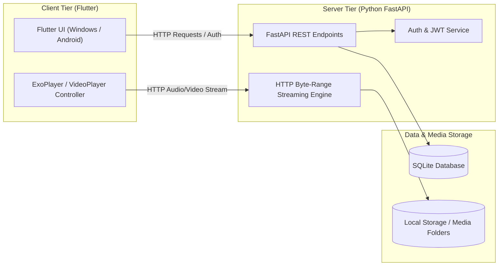
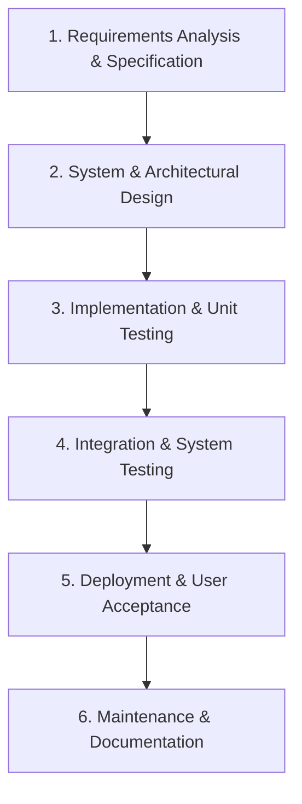
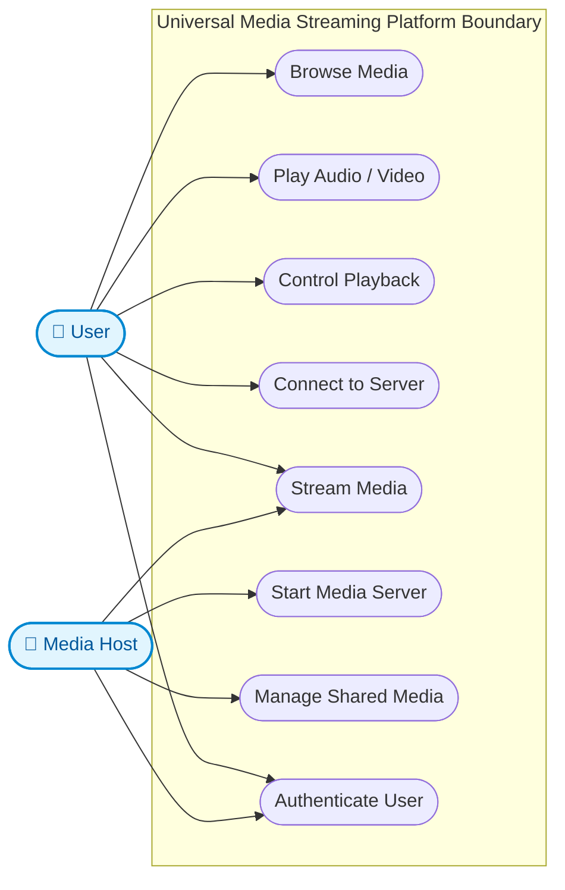
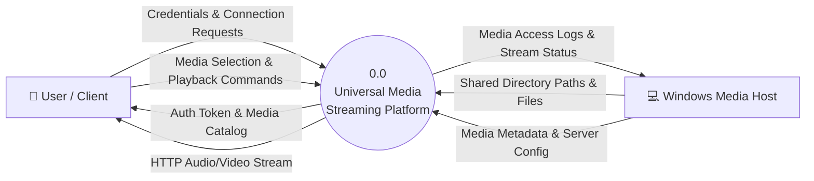
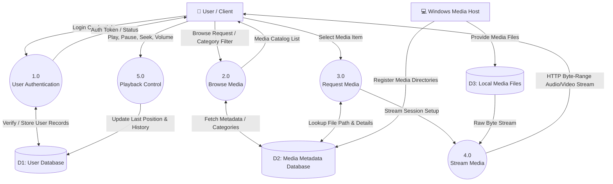
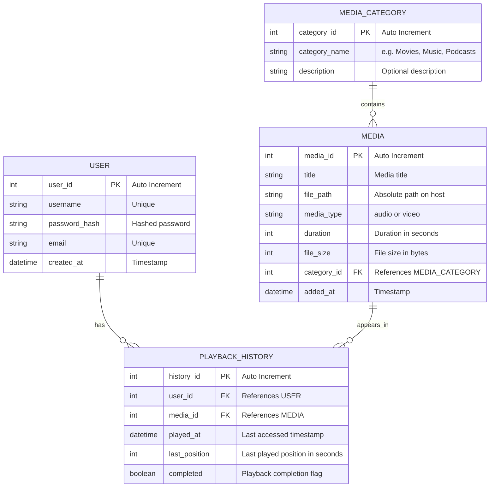

# Project Proposal: Universal Media Streaming Platform

**Course:** Software Engineering – SEA Project (M.Sc. Integrated Data Science)  
**Institution:** Goa University  
**SDLC Model:** Classical Waterfall Model  
**Date:** September 2026  
**Group Members:**
1. **Nikhil Chari** (`mscids2024.nikhil@unigoa.ac.in`)
2. **Bhiva Korkhankar** (`mscids2024.bhiva@unigoa.ac.in`)
3. **Christopher Sequeira** (`mscids2024.christopher@unigoa.ac.in`)

---

## 1. Introduction
The **Universal Media Streaming Platform** is a cross-platform media solution designed to allow users to play local audio and video files and stream media seamlessly between devices. The system supports Windows and Android platforms, enabling media sharing over local Wi-Fi networks as well as remote internet connections.

---

## 2. Problem Statement
Users frequently depend on multiple disparate applications to play and transfer media across different devices. Transferring high-definition media files over physical storage or cloud drives is often slow, cumbersome, and impractical. This project addresses these pain points by offering a unified client-server platform where users can instantly browse, access, and stream shared media files across devices without manual transfers.

---

## 3. Objectives
- **Cross-Platform Playback:** Develop a responsive media player for Windows and Android using Flutter.
- **Local Playback:** Support offline playback for audio and video formats.
- **Media Hosting & Sharing:** Enable any host device (e.g., Windows PC) to serve media across the network.
- **Network Streaming:** Provide smooth HTTP range-based streaming over local Wi-Fi and remote connections.
- **Secure Access Control:** Implement user authentication and session management.
- **Intuitive UI:** Offer an accessible, clean, and user-friendly interface.

---

## 4. Proposed System Architecture
The platform is built on a **Client-Server Architecture**:
- **Frontend (Flutter):** Provides the cross-platform UI on Windows and Android for media discovery, playback controls, host connections, and history tracking.
- **Backend (Python FastAPI):** Serves RESTful APIs, handles user authentication, exposes HTTP byte-range streaming endpoints, and scans local file directories.
- **Database (SQLite):** Lightweight, serverless relational database managing user accounts, media metadata, categories, and playback history.

---

## 5. Technology Stack

| Component | Technology | Rationale |
|---|---|---|
| **Frontend** | Flutter (Dart) | Single codebase for Windows and Android with native performance |
| **Backend** | Python FastAPI | Asynchronous high-performance framework, native support for byte-range streaming |
| **Database** | SQLite (with SQLAlchemy) | Embedded, zero-configuration relational database ideal for local media servers |
| **Streaming Protocol** | HTTP Range Requests (RFC 7233) | Enables seeking, scrubbing, and lightweight streaming over standard HTTP |
| **Testing** | Pytest & Flutter Test | Automated backend unit/integration testing and client widget testing |
| **Version Control** | Git & GitHub | Collaborative version control and milestone tracking |

---

## 6. SDLC Model: Classical Waterfall Model

The project strictly follows the **Classical Waterfall Model** with sequential phases:

---

## 7. System Diagrams

### 7.1 Diagram 1 – UML Use Case Diagram

#### Actor & Use Case Specifications

| Actor | Responsibilities |
|---|---|
| **User** | Connects to active media server, browses catalog, controls audio/video playback, and views playback history. |
| **Media Host** | Starts the media server daemon, specifies directories to share, manages access permissions, and streams media. |

---

### 7.2 Diagram 2 – Data Flow Diagram (DFD) Level 0 (Context Diagram)

---

### 7.3 Diagram 3 – Data Flow Diagram (DFD) Level 1 (Internal Processes)

---

### 7.4 Diagram 4 – Entity-Relationship Diagram (ERD)

---

## 8. Expected Outcome & Deliverables
1. **FastAPI Media Server:** Fully functional server providing REST endpoints for auth, metadata indexing, and HTTP range streaming.
2. **Flutter Media Player App:** Native Windows desktop and Android mobile app with responsive UI, playback controls, seek bar, and server discovery.
3. **Database Layer:** SQLite database preconfigured with schema migrations, relational constraints, and seed data.
4. **Waterfall Documentation Suite:** Complete SRS document, System Architecture Document, Test Plan with Pytest test cases, and final project report.
