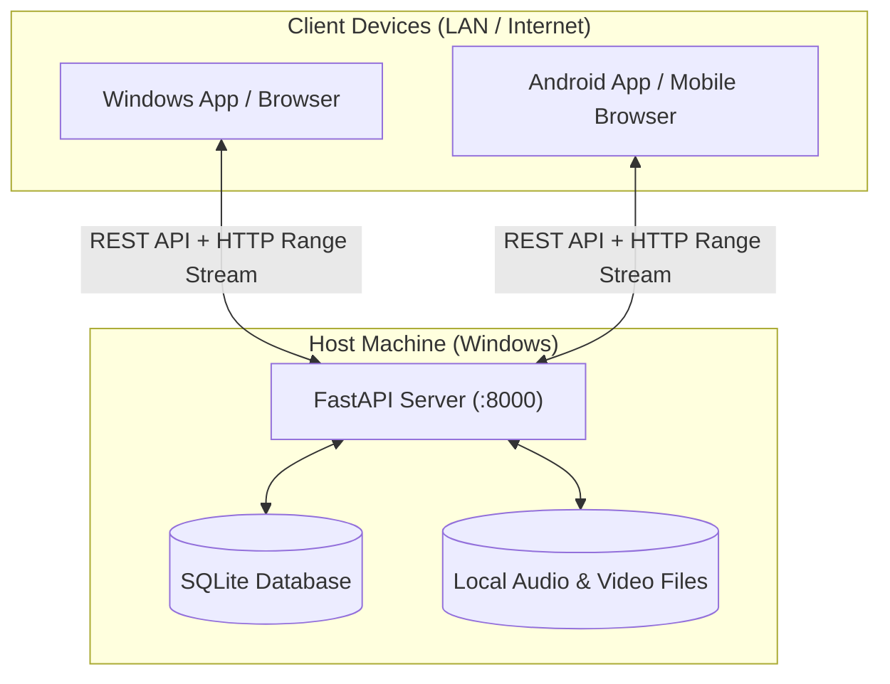

# Software Requirements Specification (SRS)
## Universal Media Streaming Platform

**Course:** Software Engineering – SEA Project (M.Sc. Integrated Data Science)  
**Institution:** Goa University  
**SDLC Model:** Classical Waterfall Model  
**Document Version:** 1.0  
**Phase:** Phase 2 – Requirements Analysis & Specification  
**Date:** September 2026  
**Project Team & Authors:**
- **Nikhil Chari** (`mscids2024.nikhil@unigoa.ac.in`) – Lead Architect & Backend Core
- **Bhiva Korkhankar** (`mscids2024.bhiva@unigoa.ac.in`) – Systems & Streaming Specialist
- **Christopher Sequeira** (`mscids2024.christopher@unigoa.ac.in`) – Client Applications & QA Lead

---

## 1. Introduction

### 1.1 Purpose
This Software Requirements Specification (SRS) document details the complete functional and non-functional requirements for the **Universal Media Streaming Platform**. It serves as the baseline agreement between the project stakeholders, development team, and evaluators for the Software Engineering project.

### 1.2 Scope of the System
The Universal Media Streaming Platform is a cross-platform client-server solution designed for Windows and Android. The system enables:
1. Local audio and video playback directly on client devices.
2. Network-based media hosting from a designated host device (such as a Windows desktop/laptop).
3. Seamless HTTP byte-range streaming across local area networks (Wi-Fi) and internet connections without requiring manual file transfers.
4. User authentication, access control, media categorization, and persistent playback history tracking.

### 1.3 Definitions, Acronyms, and Abbreviations
- **API:** Application Programming Interface
- **CORS:** Cross-Origin Resource Sharing
- **DFD:** Data Flow Diagram
- **ERD:** Entity-Relationship Diagram
- **FastAPI:** Modern, asynchronous Python web framework
- **HTTP Range Request:** Standard HTTP/1.1 protocol feature (RFC 7233) allowing clients to request specific byte ranges of a media file for seeking and buffering.
- **JWT:** JSON Web Token for stateless client authentication.
- **LAN:** Local Area Network (Wi-Fi/Ethernet)
- **MIME:** Multipurpose Internet Mail Extensions (e.g., `video/mp4`, `audio/mpeg`)
- **PK / FK:** Primary Key / Foreign Key
- **SDLC:** Software Development Life Cycle
- **SRS:** Software Requirements Specification
- **UML:** Unified Modeling Language

### 1.4 References
- IEEE Std 830-1998: IEEE Recommended Practice for Software Requirements Specifications.
- RFC 7233: Hypertext Transfer Protocol (HTTP/1.1): Range Requests.
- FastAPI Documentation (https://fastapi.tiangolo.com)
- Flutter Documentation (https://docs.flutter.dev)

---

## 2. Overall Description

### 2.1 Product Perspective
The system operates on an asynchronous client-server model:
- **Server Tier:** Built with Python FastAPI and SQLite, responsible for directory scanning, metadata indexing, user credential validation, and HTTP chunked media streaming.
- **Client Tier:** Implemented with Flutter (for native Windows and Android targets) along with an embedded responsive Web UI, providing media playback, volume/seek control, and host connection management.

### 2.2 Product Functions
1. **User Management:** Registration, login, password hashing, and JWT session authorization.
2. **Media Discovery & Indexing:** Automated scanning of host media folders with MIME type detection and metadata extraction.
3. **Categorization:** Logical organization into categories (e.g., Movies, Music, Podcasts).
4. **Range-Based Streaming:** Resumable, seekable audio/video streaming using standard HTTP 206 Partial Content responses.
5. **Playback History:** Automatic saving of last played timestamp and position (seconds) to resume playback across sessions.
6. **Host Diagnostics:** Reporting host IP, active port, number of indexed media files, and server health.

### 2.3 User Classes and Characteristics
- **Standard User (Consumer):** Connects to an existing host server, browses the shared media catalog, plays audio and video, and tracks personal playback history.
- **Media Host (Admin/Owner):** Initiates the media server daemon on their device, specifies media directories to share, triggers catalog re-scans, and manages user access.

### 2.4 Operating Environment
- **Host Server Environment:** Windows 10/11 (Python 3.10+, SQLite 3, modern networking stack).
- **Client Operating Systems:**
  - Android 8.0 (Oreo) or higher.
  - Windows 10 / 11 Desktop.
  - Modern Web Browsers (Chrome, Edge, Firefox, Safari) with HTML5 Media Source Extensions support.
- **Network Environment:** Local Wi-Fi (802.11n/ac/ax) with low latency, or routable internet connection with port forwarding / reverse proxy.

### 2.5 Design and Implementation Constraints
1. **Classical Waterfall Constraint:** Complete requirements and design artifacts must be documented before code freezing.
2. **Lightweight Footprint:** The media host must run efficiently without consuming excessive CPU or RAM, leveraging chunked streaming rather than loading entire files into memory.
3. **Database Constraint:** Zero-configuration embedded SQLite database without external DBMS server dependencies.

---

## 3. Specific Requirements

### 3.1 External Interface Requirements

#### 3.1.1 User Interfaces
- **Authentication Screen:** Simple forms for user login and registration with validation feedback.
- **Dashboard / Browse Screen:** Grid/list view displaying media items with title, duration, category badges, and media type icons.
- **Media Player Screen:** Full-featured player supporting play, pause, progress slider (scrubbing/seeking), volume slider, fullscreen toggle, and playback speed adjustment.
- **Host Management View:** Interface displaying host network address (IP:Port), folder scanning button, and directory status.

#### 3.1.2 Software Interfaces
- **FastAPI Backend REST Endpoints:** Communicating via standard JSON payloads over HTTP.
- **SQLite Engine:** Communicated through SQL queries and connection pools.

---

## 4. System Features (Functional Requirements)

### 4.1 Feature 1: User Authentication & Access Control
- **FR-1.1:** System shall permit new users to register with a unique username, valid email, and password.
- **FR-1.2:** System shall securely hash passwords using salted cryptographic hashing (SHA-256 / PBKDF2) prior to storage.
- **FR-1.3:** System shall verify credentials during login and return a signed JWT token containing user identity and expiration.
- **FR-1.4:** Protected endpoints shall validate the JWT token from the `Authorization: Bearer <token>` header.

### 4.2 Feature 2: Media Management & File Scanning
- **FR-2.1:** Host shall be capable of scanning specified directories on the file system for media files.
- **FR-2.2:** System shall recognize standard video extensions (`.mp4`, `.mkv`, `.webm`, `.avi`, `.mov`) and audio extensions (`.mp3`, `.wav`, `.ogg`, `.flac`, `.aac`, `.m4a`).
- **FR-2.3:** System shall record file metadata including title, absolute path, file size, media type (audio/video), and assigned category into the SQLite database.
- **FR-2.4:** System shall ignore inaccessible, corrupt, or unsupported file extensions gracefully without halting the scan.

### 4.3 Feature 3: Catalog Browsing & Search
- **FR-3.1:** System shall provide an endpoint to list all indexed media files with pagination and search filtering.
- **FR-3.2:** System shall allow users to filter media by category ID and by media type (`audio` or `video`).
- **FR-3.3:** System shall return category lists including item counts per category.

### 4.4 Feature 4: HTTP Byte-Range Streaming
- **FR-4.1:** Media streaming endpoint shall support HTTP `Range` request headers (e.g., `Range: bytes=1048576-`).
- **FR-4.2:** In response to a Range request, the server shall return HTTP status code `206 Partial Content`.
- **FR-4.3:** Server response shall include required headers:
  - `Content-Range: bytes <start>-<end>/<total>`
  - `Accept-Ranges: bytes`
  - `Content-Length: <chunk_size>`
  - `Content-Type: <accurate_mime_type>`
- **FR-4.4:** If no Range header is sent, server shall stream the full file with `200 OK` or chunked transfer.
- **FR-4.5:** Server shall stream data using asynchronous chunk iterators (buffer size: 64 KB to 1 MB) to maintain low memory utilization.

### 4.5 Feature 5: Playback History & Progress Tracking
- **FR-5.1:** Client shall periodically send playback progress updates (`last_position` in seconds) to the server.
- **FR-5.2:** System shall persist history records in the `playback_history` table associating `user_id`, `media_id`, and `last_position`.
- **FR-5.3:** System shall provide an endpoint to fetch the user's recent playback history so playback can resume where the user left off.

---

## 5. Non-Functional Requirements

### 5.1 Performance Requirements
- **NFR-1.1 (Latency):** Media streaming buffer initialization time shall be under 1.5 seconds on local Wi-Fi networks.
- **NFR-1.2 (Concurrency):** Server shall handle at least 10 concurrent streaming sessions simultaneously on standard consumer hardware without audio/video stutter.
- **NFR-1.3 (Memory Efficiency):** The backend process memory usage shall remain below 150 MB under normal streaming load due to streaming generators.

### 5.2 Reliability & Availability
- **NFR-2.1:** If a network connection drops momentarily, the client media player shall attempt to reconnect and resume from the last buffered byte.
- **NFR-2.2:** SQLite database transactions shall guarantee ACID properties to avoid database corruption on unexpected host power termination.

### 5.3 Security Requirements
- **NFR-3.1:** Passwords shall never be stored in plain text.
- **NFR-3.2:** Path traversal vulnerabilities (e.g. `../../sensitive_file`) shall be prevented by validating requested media file IDs strictly against authorized database entries.
- **NFR-3.3:** CORS headers shall be configured to restrict unauthorized origin access while permitting authenticated desktop and mobile client access.

### 5.4 Usability & Portability
- **NFR-4.1:** Responsive design adapting to both desktop (1920x1080, 1366x768) and mobile screens (portrait/landscape).
- **NFR-4.2:** Python backend shall run cross-platform on Windows, macOS, and Linux without platform-specific modifications.

---

## 6. Verification & Acceptance Criteria
| Requirement ID | Verification Method | Acceptance Criterion |
|---|---|---|
| **FR-1.1 - 1.4** | Automated Pytest Unit Test | User registration succeeds, password hashed, token validates protected routes. |
| **FR-2.1 - 2.4** | Integration Test | Directory scan identifies media files and populates SQLite database. |
| **FR-4.1 - 4.4** | HTTP Range Test | Client requesting bytes 1000-2000 receives exact 1001 bytes with HTTP 206. |
| **FR-5.1 - 5.3** | Functional Test | Playback position saved to history and retrieved upon next query. |
