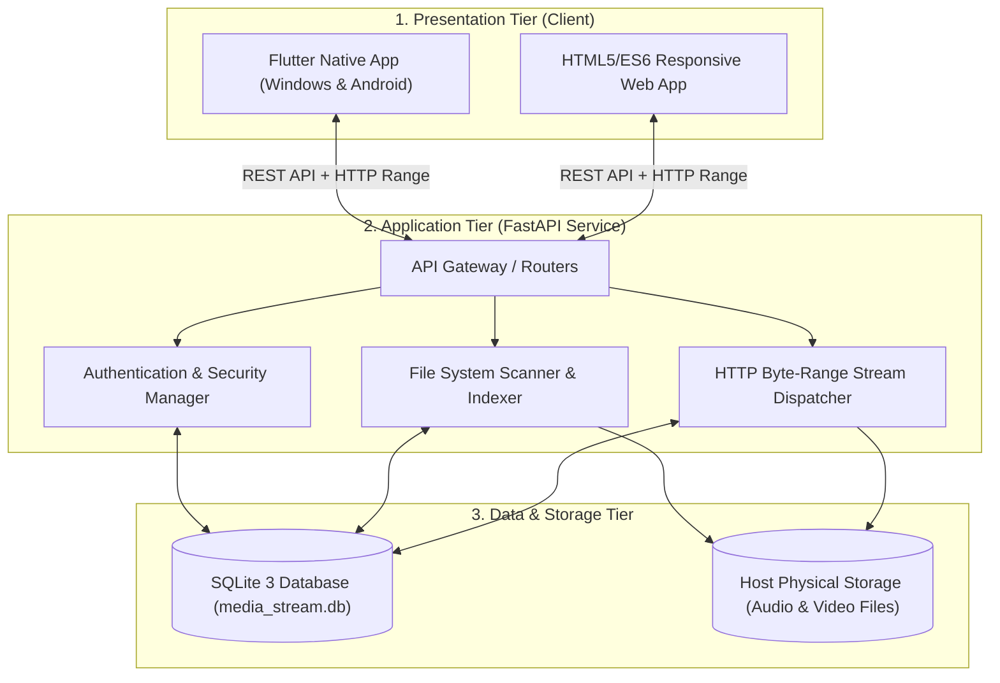
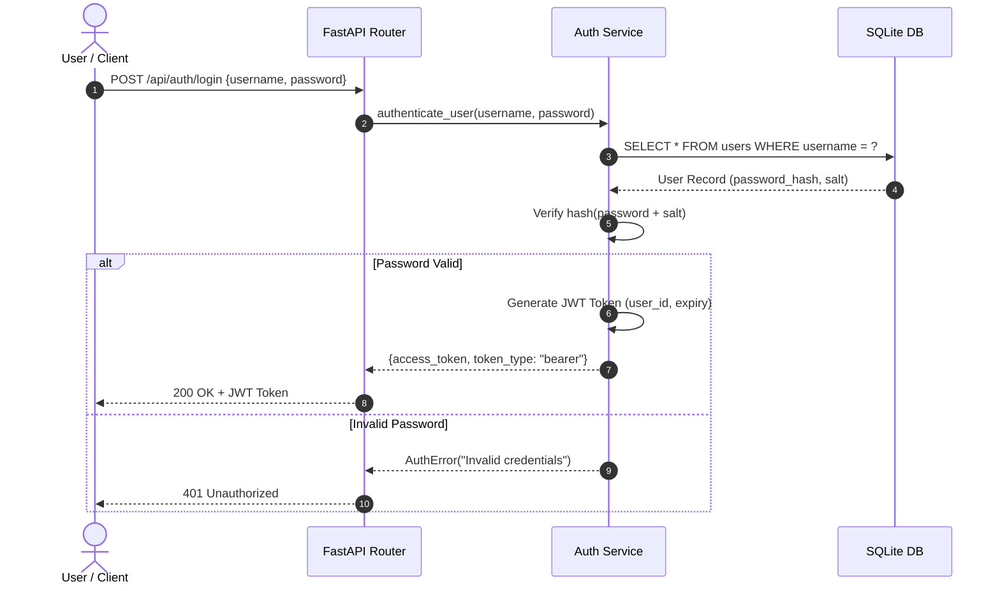
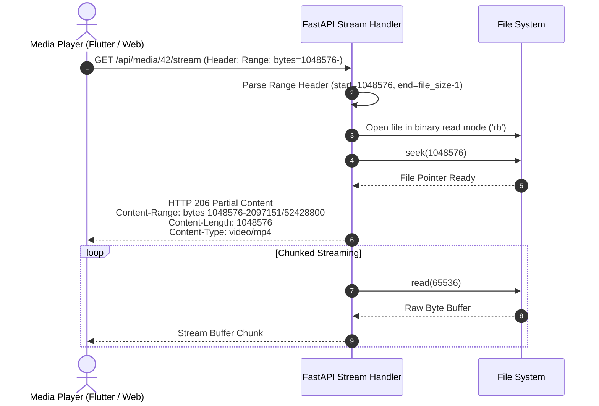
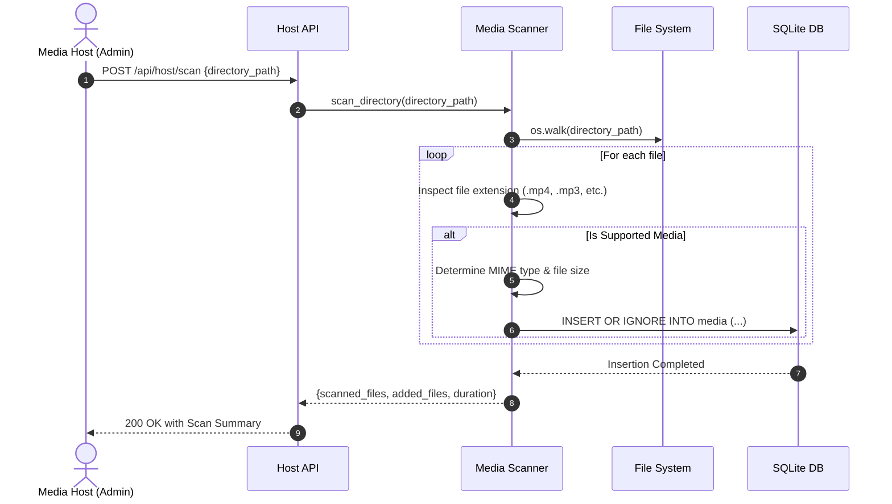

# System Design Document (HLD & LLD)
## Universal Media Streaming Platform

**Course:** Software Engineering – SEA Project (M.Sc. Integrated Data Science)  
**Institution:** Goa University  
**SDLC Model:** Classical Waterfall Model  
**Phase:** Phase 3 – System Design Specification (DSC)  
**Document Version:** 1.0  
**Date:** September – October 2026  
**Project Team & Authors:**
- **Nikhil Chari** (`mscids2024.nikhil@unigoa.ac.in`) – Database Models & Backend Security
- **Bhiva Korkhankar** (`mscids2024.bhiva@unigoa.ac.in`) – System Architecture (HLD) & HTTP Range Engine (LLD)
- **Christopher Sequeira** (`mscids2024.christopher@unigoa.ac.in`) – Client UI Design & API Interface Specification

---

## 1. High-Level Design (HLD)

### 1.1 Architectural Overview
The Universal Media Streaming Platform adopts a 3-tier **Client-Server Architecture**:
1. **Presentation Tier (Client):** Developed in Flutter (for Windows desktop & Android mobile) and accompanied by a responsive Web UI. Handles UI rendering, user interaction, media playback rendering, and local caching.
2. **Application Tier (Server):** Python FastAPI application managing business logic, user authentication, file discovery, metadata extraction, and chunked HTTP range streaming.
3. **Data Tier (Storage):** Embedded SQLite database storing structured metadata alongside the host file system storing raw media files.



---

## 2. Low-Level Design (LLD)

### 2.1 Database Schema & Data Dictionary

#### 2.1.1 Relational Schema DDL
```sql
-- 1. Users Table
CREATE TABLE IF NOT EXISTS users (
    user_id INTEGER PRIMARY KEY AUTOINCREMENT,
    username TEXT UNIQUE NOT NULL,
    password_hash TEXT NOT NULL,
    email TEXT UNIQUE NOT NULL,
    created_at TIMESTAMP DEFAULT CURRENT_TIMESTAMP
);

-- 2. Media Categories Table
CREATE TABLE IF NOT EXISTS media_categories (
    category_id INTEGER PRIMARY KEY AUTOINCREMENT,
    category_name TEXT NOT NULL UNIQUE,
    description TEXT
);

-- 3. Media Items Table
CREATE TABLE IF NOT EXISTS media (
    media_id INTEGER PRIMARY KEY AUTOINCREMENT,
    title TEXT NOT NULL,
    file_path TEXT NOT NULL UNIQUE,
    media_type TEXT NOT NULL CHECK(media_type IN ('audio', 'video')),
    mime_type TEXT NOT NULL,
    duration INTEGER DEFAULT 0,
    file_size INTEGER NOT NULL,
    category_id INTEGER,
    created_at TIMESTAMP DEFAULT CURRENT_TIMESTAMP,
    FOREIGN KEY (category_id) REFERENCES media_categories(category_id) ON DELETE SET NULL
);

-- 4. Playback History Table
CREATE TABLE IF NOT EXISTS playback_history (
    history_id INTEGER PRIMARY KEY AUTOINCREMENT,
    user_id INTEGER NOT NULL,
    media_id INTEGER NOT NULL,
    last_position INTEGER NOT NULL DEFAULT 0,
    played_at TIMESTAMP DEFAULT CURRENT_TIMESTAMP,
    FOREIGN KEY (user_id) REFERENCES users(user_id) ON DELETE CASCADE,
    FOREIGN KEY (media_id) REFERENCES media(media_id) ON DELETE CASCADE
);

CREATE INDEX IF NOT EXISTS idx_media_category ON media(category_id);
CREATE INDEX IF NOT EXISTS idx_history_user ON playback_history(user_id);
```

#### 2.1.2 Data Dictionary
| Table | Column | Type | Constraints | Description |
|---|---|---|---|---|
| `users` | `user_id` | INTEGER | PK, Auto | Unique user identifier |
| `users` | `username` | TEXT | UNIQUE, NOT NULL | Account login username |
| `users` | `password_hash` | TEXT | NOT NULL | Salted SHA-256 hash |
| `users` | `email` | TEXT | UNIQUE, NOT NULL | User contact email |
| `media_categories`| `category_id` | INTEGER | PK, Auto | Unique category ID |
| `media_categories`| `category_name`| TEXT | UNIQUE, NOT NULL | Name (Movies, Music, etc.) |
| `media` | `media_id` | INTEGER | PK, Auto | Unique media file record |
| `media` | `title` | TEXT | NOT NULL | Display title of media |
| `media` | `file_path` | TEXT | UNIQUE, NOT NULL | Absolute file location on disk |
| `media` | `media_type` | TEXT | CHECK | Either 'audio' or 'video' |
| `media` | `mime_type` | TEXT | NOT NULL | MIME (e.g. video/mp4) |
| `media` | `duration` | INTEGER | DEFAULT 0 | Estimated duration in seconds |
| `media` | `file_size` | INTEGER | NOT NULL | Size in bytes |
| `media` | `category_id` | INTEGER | FK | Refers to `media_categories` |
| `playback_history`| `history_id` | INTEGER | PK, Auto | History record ID |
| `playback_history`| `user_id` | INTEGER | FK, NOT NULL | Refers to `users` |
| `playback_history`| `media_id` | INTEGER | FK, NOT NULL | Refers to `media` |
| `playback_history`| `last_position`| INTEGER | DEFAULT 0 | Last played offset in seconds |

---

## 3. Sequence Diagrams for Core Workflows

### 3.1 Authentication Workflow


### 3.2 Media Range Streaming Workflow (RFC 7233)


### 3.3 Folder Scanning & Media Indexing Workflow


---

## 4. REST API Endpoint Specifications

| Method | Endpoint | Auth Required | Description |
|---|---|---|---|
| `POST` | `/api/auth/register` | No | Register new user account |
| `POST` | `/api/auth/login` | No | Authenticate user & return JWT token |
| `GET` | `/api/auth/me` | Yes (Bearer) | Get current authenticated user profile |
| `GET` | `/api/categories` | No | Get list of all media categories |
| `POST` | `/api/categories` | Yes | Create new media category |
| `GET` | `/api/media` | No | List media with search/category/type filter |
| `GET` | `/api/media/{id}` | No | Retrieve metadata for single media item |
| `GET` | `/api/media/{id}/stream` | Optional | Stream media with HTTP Range support |
| `POST` | `/api/history` | Yes | Record or update playback position |
| `GET` | `/api/history` | Yes | Fetch user's playback history |
| `GET` | `/api/host/status` | No | Check server health, IP address, and stats |
| `POST` | `/api/host/scan` | No (Local) | Scan folder path and index media files |

---

## 5. Software Architecture Modules

```
AntiGRav/
│
├── backend/                  # FastAPI Application
│   ├── api/                  # API Route Controllers
│   │   ├── auth.py           # Authentication endpoints
│   │   ├── media.py          # Media listing and metadata endpoints
│   │   ├── stream.py         # HTTP 206 Byte-Range streaming engine
│   │   ├── history.py        # Playback history endpoints
│   │   └── host.py           # Host status and directory scan endpoints
│   ├── database.py           # SQLite connection & schema initialization
│   ├── models.py             # Pydantic schemas for data transfer
│   ├── auth.py               # Password hashing & JWT utility
│   ├── scanner.py            # Local directory scanner & MIME detector
│   ├── static/               # Built-in Responsive Web Client (HTML/CSS/JS)
│   │   ├── index.html        # Modern dashboard & media player UI
│   │   ├── app.js            # Frontend media player controller
│   │   └── style.css         # Modern dark-theme responsive UI styles
│   └── main.py               # Application factory & CORS configuration
│
├── flutter_client/           # Flutter Cross-Platform Client
│   ├── lib/                  # Dart application source
│   │   ├── models/           # Data models (MediaItem, User)
│   │   ├── services/         # HTTP API & Streaming client services
│   │   ├── screens/          # Views: Login, Browse, Player, Host Setup
│   │   └── main.dart         # Flutter entrypoint
│   └── pubspec.yaml          # Flutter dependencies
│
├── tests/                    # Automated Pytest Suite
│   ├── conftest.py           # Test fixtures & test DB setup
│   ├── test_auth.py          # User auth & token verification tests
│   ├── test_database.py      # SQLite schema & CRUD operation tests
│   ├── test_scanner.py       # File scanner & MIME detection tests
│   └── test_streaming.py     # HTTP 206 range header verification tests
│
├── create_sample_media.py    # Synthetic media generation utility
├── PROPOSAL.md               # Project proposal with UML & DFDs
├── SRS.md                    # Software Requirements Specification
├── SYSTEM_DESIGN.md          # High-Level & Low-Level System Design
├── TESTING.md                # Test Plan & Verification Matrix
└── run_server.py             # Quick server launcher script
```
